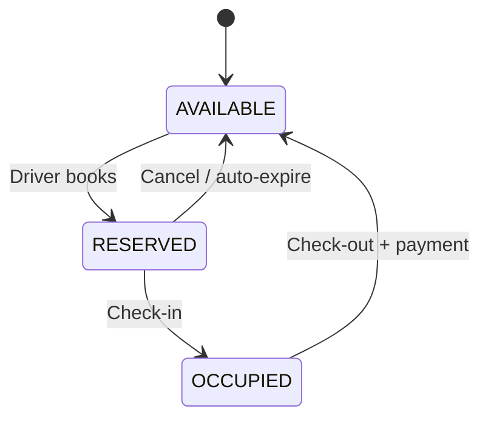
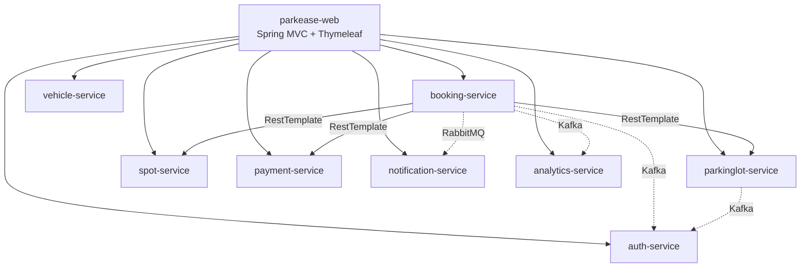

Readme · MD
<div align="center">
# 🅿️ ParkEase
 
### Find. Reserve. Park. Effortlessly.
 
A smart parking lot management platform built with **Java Spring Boot microservices**.
 


 
</div>
---
 
## 📖 About
 
**ParkEase** connects **drivers** looking for parking with **lot managers** who run parking facilities. Drivers search for lots, reserve a spot, check in and out digitally, and pay online. Managers control their lots and see earnings. Admins keep the whole platform in check.
 
This project is a BridgeLabz case study, designed as independent microservices where every service owns its own database.
 
## ✨ Features
 
### 🚗 Driver
- Register and log in with email/password or Google/GitHub OAuth
- Add multiple vehicles (2W / 4W / Heavy, EV flag)
- Search lots by city or by GPS location (nearby lots)
- Filter spots by type: Compact, Standard, Large, Motorbike, EV, Handicapped
- Pre-book a spot or make a walk-in booking
- Digital check-in, check-out and booking extension
- Pay by card, UPI, wallet or cash on exit, and download PDF receipts
- Cancel within the allowed window and get a refund
### 🏢 Lot Manager
- Register a lot and wait for admin approval
- Add spots one by one or in bulk, with per-spot pricing
- Open or close the lot in real time
- View bookings, occupancy, peak hours and revenue
- Download daily occupancy and revenue reports
### 🛡️ Admin
- Approve or reject lots with feedback
- Suspend, reactivate or delete users
- View platform-wide bookings, payments and analytics
- Send broadcast notifications
- View **audit logs** of all critical actions
## 🔄 How a Booking Works
 

 
**Fare** = `(checkOutTime − checkInTime) × pricePerHour`, with a minimum 1-hour charge.
 
## 🏗️ Architecture
 

 
Each service has its own database. Services talk to each other using **IDs only**, with no cross-database foreign keys.
 
**Messaging:**
 
| Broker | Used for |
|---|---|
| **RabbitMQ** | Notification dispatch (booking confirmed, expiry reminder, receipt) |
| **Apache Kafka** | Event streaming: occupancy-log events to `analytics-service`, and audit events (lot approval, cancellation, manual checkout) to `auth-service` |
 
| Service | Package | Database | Responsibility |
|---|---|---|---|
| `auth-service` | `com.parkease.auth` | `parkease_auth` | Register, login, JWT, OAuth2, profile, **audit logs** |
| `parkinglot-service` | `com.parkease.parkinglot` | `parkease_parkinglot` | Lot profiles, nearby search, approval |
| `spot-service` | `com.parkease.spot` | `parkease_spot` | Spot CRUD, status, bulk create |
| `booking-service` | `com.parkease.booking` | `parkease_booking` | Booking lifecycle |
| `payment-service` | `com.parkease.payment` | `parkease_payment` | Payments, refunds, wallet, receipts |
| `vehicle-service` | `com.parkease.vehicle` | `parkease_vehicle` | Vehicle registration |
| `notification-service` | `com.parkease.notification` | `parkease_notification` | In-app, email, SMS alerts |
| `analytics-service` | `com.parkease.analytics` | `parkease_analytics` | Occupancy, peak hours, revenue |
| `parkease-web` | `com.parkease.web` | — | Spring MVC controllers, Thymeleaf views |
 
## 🗄️ Database Design
 
| Service | Tables |
|---|---|
| auth | `users`, `refresh_tokens`, `audit_logs` |
| parkinglot | `parking_lots` |
| spot | `parking_spots` |
| booking | `bookings` |
| payment | `payments`, `wallets`, `wallet_transactions` |
| vehicle | `vehicles` |
| notification | `notifications` |
| analytics | `occupancy_logs` |
 
Key design choices:
 
- **Optimistic locking** (`version` column) on spots, bookings, lots and wallets prevents double-booking.
- **Soft delete** (`is_deleted`, `is_active`) keeps old bookings and payments valid.
- **Haversine formula** with an index on `latitude, longitude` powers the nearby-lot search.
- **Audit trail** records the actor, the action, and the before/after values.
The full SQL is in [`parkease_schema_v4.sql`](./parkease_schema_v4.sql).
 
## 🛠️ Tech Stack
 
| Layer | Technology |
|---|---|
| Backend | Java, Spring Boot 4.1.1, Spring MVC, Spring Security, Spring Data JPA |
| Auth | JWT, OAuth2 (Google / GitHub), bcrypt |
| Database | MySQL 8, Redis |
| Messaging | RabbitMQ (notifications), Apache Kafka (event streaming) |
| Frontend | Thymeleaf, Bootstrap 5, Leaflet.js |
| Payments | Razorpay / Stripe |
| Storage | AWS S3 (lot images, PDF receipts) |
| DevOps | Docker, Docker Compose, GitHub Actions |
| API Docs | Swagger / OpenAPI 3 |
 
## 🚀 Getting Started
 
### Prerequisites
- JDK 17+
- Maven
- MySQL 8.0.16 or newer
- Redis, RabbitMQ and Apache Kafka (or Docker)
### Setup
 
```bash
# 1. Clone the repository
git clone https://github.com/Ov-Manish/parkease.git
cd parkease
 
# 2. Create all databases and tables
mysql -u root -p < parkease_schema_v4.sql
 
# 3. Start a service (example: auth-service)
cd auth-service
mvn spring-boot:run
```
 
> API paths are versioned under `/api/v1/`. Swagger UI is available on each service at `/swagger-ui.html`.
 
## 📁 Project Structure
 
```
parkease/
├── auth-service/
├── parkinglot-service/
├── spot-service/
├── booking-service/
├── payment-service/
├── vehicle-service/
├── notification-service/
├── analytics-service/
├── parkease-web/
├── parkease_schema_v4.sql
└── README.md
```
 
## 🗺️ Roadmap
 
- [x] Requirement analysis and use cases
- [x] Database schema design
- [ ] auth-service
- [ ] vehicle-service
- [ ] parkinglot-service
- [ ] spot-service
- [ ] booking-service
- [ ] payment-service
- [ ] notification-service
- [ ] analytics-service
- [ ] parkease-web (Thymeleaf UI)
- [ ] Kafka topics and event flow
- [ ] Docker Compose setup
## 👨‍💻 Author
 
Built by **Over** as part of the BridgeLabz Java Full Stack Fellowship.
 
GitHub: [@Ov-Manish](https://github.com/Ov-Manish)
 
---
 
<div align="center">
⭐ If you like this project, give it a star!
</div>
 


Claude finished the response
