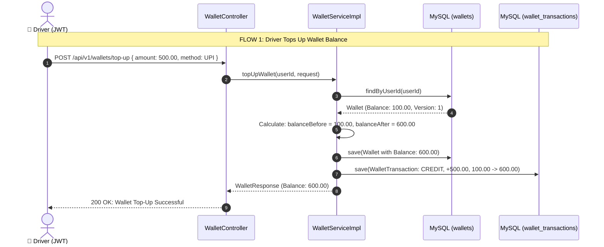
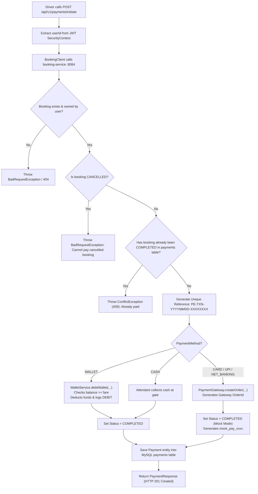

# ParkEase Payment-Service: Controller & Service Architecture Deep Dive

This comprehensive technical guide explains how **`payment-service`** (Port `8085`) processes financial transactions, coordinates in-app driver digital wallets, enforces concurrency safety, and interfaces with `booking-service` and third-party payment gateways.

---

## 1. High-Level System Architecture & Flow

```mermaid
flowchart TD
    subgraph ClientLayer ["Client Layer"]
        DriverApp["🚗 Driver Mobile / Web / Postman"]
    end

    subgraph PaymentService ["Payment-Service (Port 8085)"]
        subgraph Controllers ["REST Controller Layer"]
            WalletCtrl["WalletController<br>/api/v1/wallets"]
            PaymentCtrl["PaymentController<br>/api/v1/payments"]
        end

        subgraph SecurityFilter ["Security & Context"]
            JwtFilter["JwtAuthenticationFilter<br>(Extracts userId & ROLE_*)"]
        end

        subgraph Services ["Service Layer"]
            WalletSvc["WalletServiceImpl<br>(Balance & Ledger)"]
            PaymentSvc["PaymentServiceImpl<br>(Orchestrator)"]
        end

        subgraph Adapters ["Clients & Adapters"]
            BClient["BookingClient<br>(REST over HTTP)"]
            PGateway["PaymentGateway<br>(Mock / Razorpay)"]
        end

        subgraph Persistence ["Persistence Layer (MySQL :3309)"]
            WRepo[("wallets")]
            TRepo[("wallet_transactions")]
            PRepo[("payments")]
        end
    end

    subgraph ExternalServices ["External Microservices"]
        BookingSvc["📦 booking-service<br>(Port 8084)"]
    end

    %% Wiring
    DriverApp -->|Bearer JWT| JwtFilter
    JwtFilter --> Controllers
    WalletCtrl --> WalletSvc
    PaymentCtrl --> PaymentSvc

    PaymentSvc --> BClient
    PaymentSvc --> WalletSvc
    PaymentSvc --> PGateway

    BClient -->|HTTP GET /bookings/{id}| BookingSvc

    WalletSvc --> WRepo
    WalletSvc --> TRepo
    PaymentSvc --> PRepo
```

---

## 2. Wallet Subsystem: Balance Management & Ledger

The wallet subsystem functions like an in-app digital bank account (e.g. Apple Cash or Starbucks Card). It uses two database tables:
1. **`wallets`**: Stores current balance, user link, and an `@Version` column for optimistic locking.
2. **`wallet_transactions`**: An immutable financial audit log recording every single `balanceBefore` and `balanceAfter` snapshot.

### Wallet Execution Sequence Diagram



---

### Wallet Method Mapping & Logic

| Controller Method | Endpoint & Role | Target Service Method | Core Logic & Invariants |
| :--- | :--- | :--- | :--- |
| **`getMyWallet`** | `GET /api/v1/wallets/me`<br>`hasRole('DRIVER')` | **`getOrCreateWallet(userId)`** | If driver exists, returns wallet balance. If first-time driver, auto-initializes active wallet with `0.00` balance. Prevents null pointer errors on mobile apps. |
| **`topUpWallet`** | `POST /api/v1/wallets/top-up`<br>`hasRole('DRIVER')` | **`topUpWallet(userId, request)`** | Validates `amount >= 10.00`. Calculates `balanceAfter = balanceBefore + amount`. Persists updated wallet and inserts an immutable `CREDIT` row in `wallet_transactions`. Wrapped in `@Transactional`. |
| **`getTransactionStatements`** | `GET /api/v1/wallets/transactions`<br>`hasRole('DRIVER')` | **`getTransactionStatements(userId)`** | Queries `wallet_transactions` sorted by `createdAt DESC`. Returns a statement/passbook of every credit, debit, reference ID, and description. |

---

## 3. Payment Subsystem: Parking Booking Checkout

The payment subsystem handles the settlement of parking tickets. It ensures **idempotency**, **ownership verification**, and **double-payment prevention**.

### Booking Payment Flowchart



---

### Payment Method Mapping & Logic

| Controller Method | Endpoint & Role | Target Service Method | Core Logic & Invariants |
| :--- | :--- | :--- | :--- |
| **`initiatePayment`** | `POST /api/v1/payments/initiate`<br>`hasRole('DRIVER')` | **`processPayment(userId, request, token)`** | 1. **Cross-Service Validation:** Calls `booking-service` via `BookingClient` to verify ticket exists, belongs to caller, and isn't cancelled.<br>2. **Anti-Double-Pay:** Checks `paymentRepository.findByBookingId()`. Throws 409 Conflict if already paid.<br>3. **Reference Generation:** Creates `PE-TXN-YYYYMMDD-XXXXXXXX`.<br>4. **Funding Execution:** Deducts from wallet or initiates gateway order.<br>5. **Persistence:** Saves record with status `COMPLETED`. |
| **`verifyPayment`** | `POST /api/v1/payments/verify`<br>Public / Callback | **`verifyPayment(request)`** | Verifies cryptographic signature (`paymentGateway.verifyPaymentSignature`) from external gateway webhooks. Marks status `COMPLETED` on match, or `FAILED` on mismatch. |
| **`refundPayment`** | `POST /api/v1/payments/refund`<br>`DRIVER, LOT_MANAGER, ADMIN` | **`refundPayment(userId, role, request)`** | 1. **Auth Guard:** Verifies caller owns ticket or is Admin/Manager.<br>2. **Math Guard:** Ensures `refundAmount <= amount - alreadyRefunded`.<br>3. **Source Routing:** If paid by `WALLET`, credits funds back to wallet via `creditRefund`. If paid via Gateway, calls gateway refund API.<br>4. **Status Update:** Marks `REFUNDED` or `PARTIALLY_REFUNDED`. |
| **`getPaymentById`** | `GET /api/v1/payments/{paymentId}`<br>`DRIVER, LOT_MANAGER, ADMIN` | **`getPaymentById(paymentId, userId, role)`** | Retrieves payment receipt. Drivers can only view their own receipts; Admins and Lot Managers can inspect any receipt. |
| **`getPaymentByBookingId`** | `GET /api/v1/payments/booking/{bookingId}`<br>`DRIVER, LOT_MANAGER, ADMIN` | **`getPaymentByBookingId(bookingId, userId, role)`** | Retrieves payment receipt attached to a specific booking ID. |
| **`getMyPayments`** | `GET /api/v1/payments/my-payments`<br>`hasRole('DRIVER')` | **`getUserPayments(userId)`** | Returns all payment receipts issued to the logged-in driver, sorted newest first. |

---

## 4. Financial Calculations & State Transitions

### A. Fare Settlement Formula

The expected fee is extracted from `booking-service`:
$$\text{Expected Fare} = \begin{cases} \text{totalAmount}, & \text{if driver completed checkout (includes overstay)} \\ \text{baseFare}, & \text{if pre-booking reservation only} \end{cases}$$

### B. Wallet Balance Deduction Formula
When a driver pays via `WALLET`:
1. Check:
   $$\text{Available Balance} \ge \text{Billed Fare}$$
   *(If false, throws `InsufficientBalanceException`).*
2. Snapshot Calculation:
   $$\text{balanceBefore} = \text{Current Wallet Balance}$$
   $$\text{balanceAfter} = \text{balanceBefore} - \text{Billed Fare}$$
3. Concurrency Protection:
   Hibernate automatically checks `@Version` on `Wallet`. If two payments hit at the same millisecond, the second transaction collides and rolls back cleanly without double-spending.

### C. Refund Allowance Formula
When processing a refund (e.g. after booking cancellation):
$$\text{Max Refundable} = \text{Original Amount} - \text{Already Refunded}$$
If $\text{Requested Refund} > \text{Max Refundable}$, the system immediately rejects with HTTP 400 Bad Request.

---

## 5. Security & Multi-Role Access Control Matrix

| Endpoint | HTTP Method | Permitted Roles | Notes |
| :--- | :--- | :--- | :--- |
| `/api/v1/wallets/me` | `GET` | `DRIVER` | Isolated to caller's `userId`. |
| `/api/v1/wallets/top-up` | `POST` | `DRIVER` | Top-up caller's own wallet. |
| `/api/v1/wallets/transactions` | `GET` | `DRIVER` | Passbook statement of caller. |
| `/api/v1/payments/initiate` | `POST` | `DRIVER` | Settle booking parking fee. |
| `/api/v1/payments/verify` | `POST` | **PermitAll** | Gateway webhook signature callback. |
| `/api/v1/payments/refund` | `POST` | `DRIVER`, `LOT_MANAGER`, `ADMIN` | Driver can refund own booking; Managers/Admins can refund any. |
| `/api/v1/payments/{paymentId}` | `GET` | `DRIVER`, `LOT_MANAGER`, `ADMIN` | Ownership enforced for drivers. |
| `/api/v1/payments/booking/{bookingId}` | `GET` | `DRIVER`, `LOT_MANAGER`, `ADMIN` | Ownership enforced for drivers. |
| `/api/v1/payments/my-payments` | `GET` | `DRIVER` | Driver's personal receipt list. |
| `/swagger-ui/**`, `/v3/api-docs/**` | `GET` | **PermitAll** | Swagger UI and OpenAPI documentation. |

---

## 6. Code Review Checklist: Key Questions to Prepare For

1. **Why do we have both `PaymentGateway` and `MockPaymentGateway`?**  
   *Answer:* It implements the **Adapter Pattern**. It allows the team to run tests locally with zero third-party dependencies, while enabling a one-line configuration switch to real Razorpay or Stripe when deploying to production.

2. **Why does `Wallet` have a `@Version` field?**  
   *Answer:* It enables **Optimistic Locking**. In high-concurrency systems, if a driver double-taps "Pay" on mobile or has concurrent requests, `@Version` prevents race conditions where both requests read the same balance and double-spend.

3. **Why do `balanceBefore` and `balanceAfter` exist in `wallet_transactions`?**  
   *Answer:* In banking and fintech, ledgers must be **immutable and traceable**. Having historical balance snapshots allows instant audit reconciliation without having to re-calculate all past transactions from time zero.

4. **Why does `BookingClient` verify the booking before `PaymentService` creates the transaction?**  
   *Answer:* Trust boundary separation. The client payload could be spoofed with a fake amount or another user's booking ID. Calling `booking-service` guarantees that the ticket is authentic, owned by the payer, and not cancelled.
